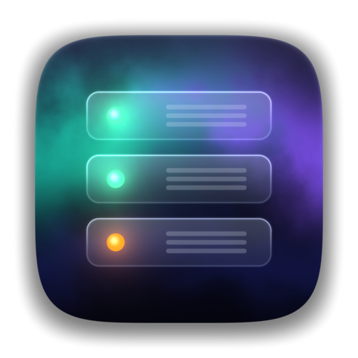
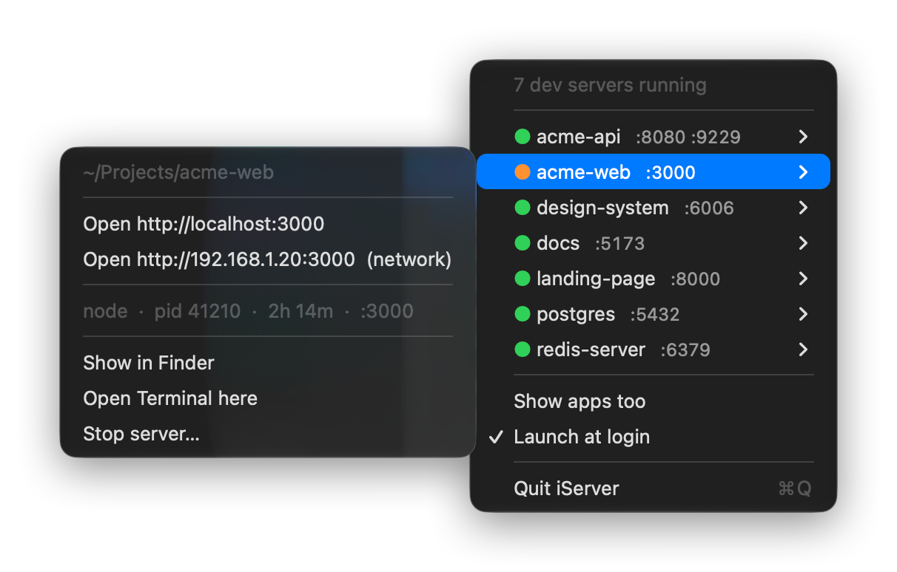

<p align="center">
  
</p>

<h1 align="center">iServer</h1>

<p align="center">
  <strong>Every dev server running on your Mac, one click away in the menu bar.</strong>
</p>

<p align="center">
  <a href="https://github.com/AntoniovanDijck/iServer/releases/latest"></a>
  
  
  <a href="https://github.com/AntoniovanDijck/iServer/actions/workflows/build.yml"></a>
  <a href="LICENSE"></a>
</p>

<p align="center">
  
</p>

---

`next dev` in one tab, a Vite server you forgot about, a Postgres from last week, a `python -m http.server` an AI agent started somewhere… **iServer** puts them all in your menu bar, named after their project, with one click to open, reveal or stop them.

## Features

- 🔎 **Finds every local server**: any process listening on a TCP port, named after the project folder it runs in
- 🧩 **Groups related processes**: Electron + its Vite server, or Node + an embedded Postgres, show up as one project
- 🟠 **Flags exposed servers**: orange means it listens on all interfaces and is reachable from your network
- 🌐 **Open in the browser**: via `localhost`, or via your LAN IP for exposed servers
- 📂 **Jump to the project** in Finder or a new Terminal window
- 🛑 **Stop a server** with SIGTERM (after confirming)
- 🤖 **Knows AI agents**: servers started from a Claude Code scratchpad are labelled with their project
- 🪶 **Tiny**: one Swift file, no dependencies, a ~200 KB binary, no permissions needed

## Install

### Download

1. Download **iServer.zip** from the [latest release](https://github.com/AntoniovanDijck/iServer/releases/latest)
2. Unzip it and drag **iServer.app** to your Applications folder
3. Open it. The app is not notarized, so macOS will ask the first time: right-click → **Open**, or run:

   ```bash
   xattr -dr com.apple.quarantine /Applications/iServer.app
   ```

### Build from source

All you need is the Xcode Command Line Tools (`xcode-select --install`).

```bash
git clone https://github.com/AntoniovanDijck/iServer.git
cd iServer
./build.sh --install
```

This builds `iServer.app`, copies it to `~/Applications` and launches it.

## Usage

Click the server icon in the menu bar. The number next to it is how many projects have a server running.

| | |
|---|---|
| 🟢 / 🟠 | Local only / reachable from your network |
| **Show apps too** | Also list regular apps that open ports (Chrome, Spotify, AirPlay…) |
| **Launch at login** | Start iServer automatically |

It also works from the command line:

```bash
iServer --list         # print running dev servers
iServer --list --all   # include regular apps
iServer --demo         # show sample data, e.g. for screenshots
```

(`iServer` is at `/Applications/iServer.app/Contents/MacOS/iServer`.)

## How it works

Every 5 seconds iServer:

1. lists listening TCP sockets with `lsof -iTCP -sTCP:LISTEN`
2. skips system services and apps installed in `/Applications`
3. walks the process tree (`ps`) so child processes are grouped under the server that started them
4. reads each process's working directory and turns it into a project name (`~/Projects/acme-web` → **acme-web**)

It only sees processes owned by your user, without any special permissions.

## FAQ

<details>
<summary><strong>A server I expect isn't listed</strong></summary>

If its binary lives inside an app in `/Applications` (LM Studio, Docker Desktop without containers…), it's hidden by default. Turn on **Show apps too**.
</details>

<details>
<summary><strong>Does it use much battery?</strong></summary>

No. It runs `lsof` and `ps` once every 5 seconds, which takes a few milliseconds.
</details>

<details>
<summary><strong>Which languages does it support?</strong></summary>

English, and Dutch when Dutch is your preferred macOS language.
</details>

## The icon

The app icon is rendered by a Metal fragment shader (signed distance fields, fbm noise for the aurora, bloom on the status LEDs). To tweak and re-render it:

```bash
./scripts/make-icon.sh   # renders scripts/IconShader.swift → Resources/AppIcon.icns
```

## Contributing

Issues and pull requests are welcome. Please keep it a single file with no dependencies.

## License

[MIT](LICENSE) © 2026 Antonio van Dijck
